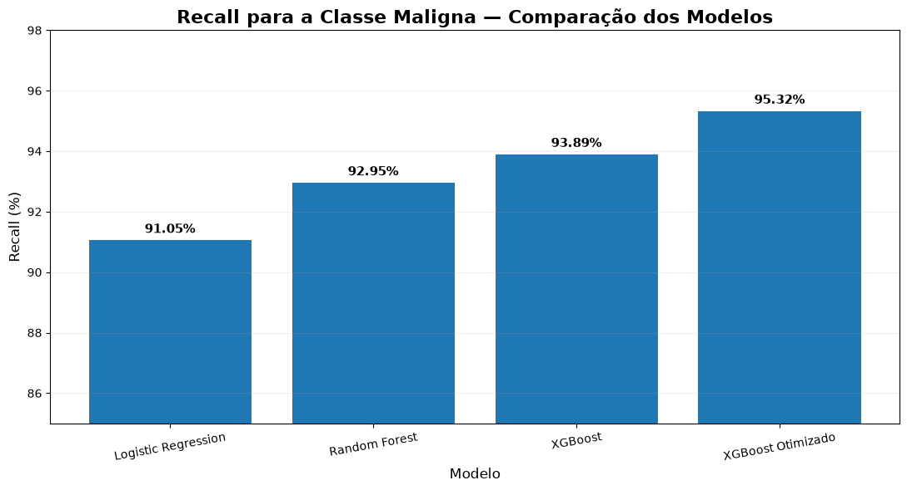
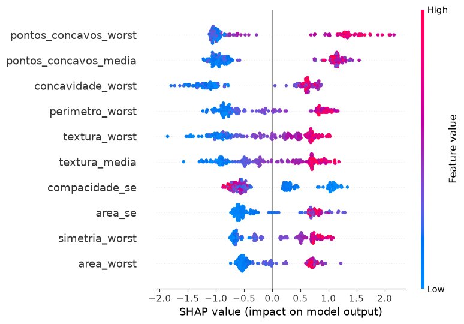
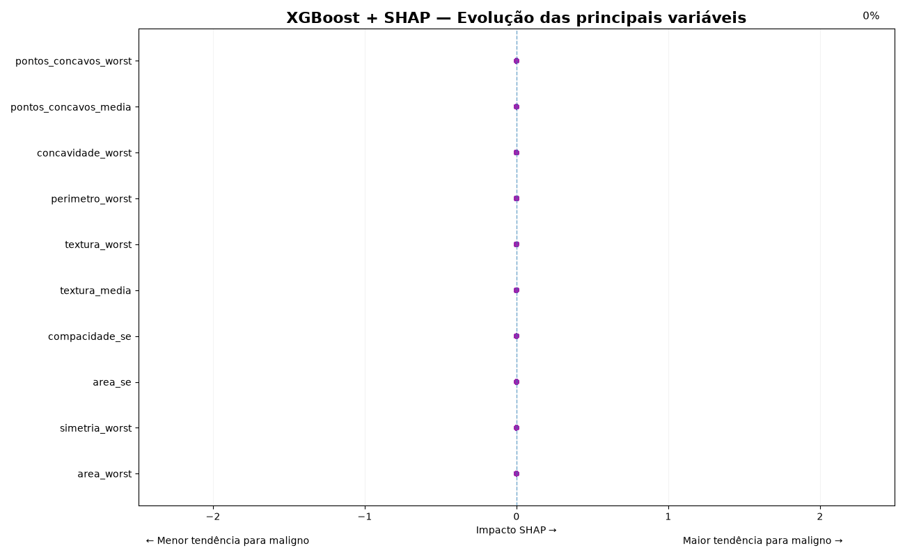

<p align="center">
  
</p>


# 🩺 Breast Cancer Classification — Machine Learning

Projeto de **Machine Learning para classificação de tumores mamários como benignos ou malignos**, desenvolvido utilizando o **Breast Cancer Wisconsin Diagnostic Dataset**.

O objetivo foi comparar diferentes algoritmos de classificação, avaliar seus desempenhos e utilizar técnicas de **Explainable AI (XAI)** para compreender quais características mais influenciam as previsões do modelo.

> ⚠️ **Aviso:** este projeto possui finalidade exclusivamente educacional e de demonstração de técnicas de Machine Learning. O modelo não deve ser utilizado para diagnóstico médico real.

---

## 🎯 Objetivo

Desenvolver e avaliar modelos capazes de classificar tumores como:

* 🟢 **Benigno**
* 🔴 **Maligno**

Além do desempenho preditivo, o projeto também busca compreender **como o modelo toma suas decisões**, utilizando SHAP para análise de interpretabilidade.

---

## 📊 Dataset

Foi utilizado o **Breast Cancer Wisconsin Diagnostic Dataset (WDBC)**.

O dataset contém características computadas a partir de imagens digitalizadas de biópsias, relacionadas à morfologia dos núcleos celulares.

A variável alvo representa:

* `0` → Benigno
* `1` → Maligno

Os arquivos originais do dataset estão disponíveis na pasta:

```text
data/
├── wdbc.data
└── wdbc.names
```

---

## 🔬 Modelos avaliados

Foram utilizados três algoritmos de classificação:

### Logistic Regression

Utilizado como modelo baseline por sua simplicidade e interpretabilidade.

### Random Forest

Modelo baseado em múltiplas árvores de decisão, capaz de capturar relações não lineares entre as variáveis.

### XGBoost

Algoritmo baseado em Gradient Boosting, utilizado para capturar relações mais complexas nos dados.

Após a comparação dos modelos, foi realizada uma **otimização dos hiperparâmetros do XGBoost**.

---

## ⚙️ XGBoost Otimizado

Os principais hiperparâmetros utilizados foram:

```python
{
    "colsample_bytree": 0.8,
    "learning_rate": 0.1,
    "max_depth": 4,
    "n_estimators": 300,
    "subsample": 0.8
}
```

---

## 🏆 Resultados

O XGBoost otimizado apresentou os seguintes resultados no conjunto de teste:

| Métrica   |  Resultado |
| --------- | ---------: |
| Accuracy  | **97,19%** |
| Precision | **96,72%** |
| Recall    | **95,76%** |
| F1-Score  | **96,18%** |
| ROC-AUC   | **99,43%** |

O **Recall de 95,76% para a classe maligna** indica que o modelo identificou corretamente a maior parte dos casos malignos presentes no conjunto de teste.

---

## 📈 Comparação dos Modelos

A comparação foi realizada utilizando diferentes métricas de avaliação, incluindo Accuracy, Precision, Recall, F1-Score e ROC-AUC.

### Comparação de desempenho


### Recall da classe maligna

O Recall foi analisado com atenção especial devido à importância de identificar corretamente os casos malignos.



---

## 🎯 Matriz de Confusão

A matriz de confusão permite visualizar os acertos e erros do XGBoost otimizado.


A matriz apresenta:

* **True Positive (TP):** casos malignos corretamente classificados.
* **True Negative (TN):** casos benignos corretamente classificados.
* **False Positive (FP):** casos benignos classificados como malignos.
* **False Negative (FN):** casos malignos classificados como benignos.

Os **falsos negativos** são especialmente importantes na análise, pois representam casos malignos que não foram identificados pelo modelo.

---

## 🔎 Explainable AI — SHAP

Para compreender o comportamento do XGBoost, foi utilizada a técnica **SHAP (SHapley Additive exPlanations)**.

O SHAP permite analisar:

* quais características possuem maior influência;
* como valores altos ou baixos das características afetam as previsões;
* quais variáveis contribuem para aumentar ou diminuir a saída do modelo.

### SHAP Summary Plot



O gráfico permite observar simultaneamente a **importância das características** e a **direção de seus impactos nas previsões**.

---

## 🎬 SHAP Animation

Além do gráfico estático, foi desenvolvida uma animação para visualizar de forma dinâmica a contribuição das principais características nas previsões do modelo.



---

## 🧠 Pipeline do Projeto

```text
Dataset
   ↓
Análise exploratória
   ↓
Pré-processamento
   ↓
Separação treino / teste
   ↓
Treinamento dos modelos
   ↓
Comparação de desempenho
   ↓
Otimização do XGBoost
   ↓
Avaliação final
   ↓
Explainable AI — SHAP
```

---

## 🛠️ Tecnologias Utilizadas

* 🐍 **Python**
* 🐼 **Pandas**
* 🔢 **NumPy**
* 🤖 **Scikit-learn**
* 🚀 **XGBoost**
* 🔍 **SHAP**
* 📊 **Matplotlib**
* 📓 **Jupyter Notebook**
* 🧑‍🎨 **SEABORN**

---

## 📂 Estrutura do Projeto

```text
Breast-Cancer-Classification/
│
├── README.md
├── LICENSE
├── .gitignore
│
├── data/
│   ├── wdbc.data
│   └── wdbc.names
│
├── images/
│   ├── comparacao dos modelos.png
│   ├── matriz de confusao.png
│   ├── recall.png
│   └── shap.png
│
├── animation/
│   └── shap_top10_breast_cancer.gif
│
└── notebook/
    └── breast_cancer.ipynb
```

---

## 🚀 Como Executar

### 1. Clone o repositório

```bash
git clone https://github.com/Jonatan-Trindade/Breast-Cancer-Classification.git
```

### 2. Entre na pasta

```bash
cd Breast-Cancer-Classification
```

### 3. Crie um ambiente virtual

```bash
python -m venv .venv
```

### 4. Ative o ambiente virtual

No Windows:

```bash
.venv\Scripts\activate
```

### 5. Instale as dependências

```bash
pip install pandas numpy scikit-learn xgboost shap matplotlib jupyter
```

### 6. Execute o notebook

Abra:

```text
notebook/breast_cancer.ipynb
```

e execute as células para reproduzir a análise, treinamento e avaliação dos modelos.

---

## 📌 Principais Aprendizados

Durante o desenvolvimento deste projeto foram explorados conceitos de:

* classificação supervisionada;
* análise e preparação de dados;
* treinamento de modelos de Machine Learning;
* comparação de algoritmos;
* avaliação por múltiplas métricas;
* otimização de hiperparâmetros;
* matriz de confusão;
* ROC-AUC;
* análise de Recall;
* importância de variáveis;
* Explainable AI;
* interpretação de modelos utilizando SHAP.

---

## 🔮 Próximos Passos

* [ ] Criar uma aplicação web utilizando Streamlit;
* [ ] Disponibilizar o modelo através de uma API;
* [ ] Criar uma interface para realizar previsões;
* [ ] Adicionar validação cruzada mais detalhada;
* [ ] Explorar técnicas adicionais de Explainable AI;
* [ ] Implementar monitoramento do modelo;
* [ ] Containerizar a aplicação utilizando Docker.

---

## 👨‍💻 Autor

**JONATAN TRINDADE**

Projeto desenvolvido como parte do meu portfólio de **Data Science e Machine Learning**, com foco em classificação, avaliação de modelos e Explainable AI.

---

⭐ Se este projeto foi útil ou interessante para você, considere deixar uma estrela no repositório!
